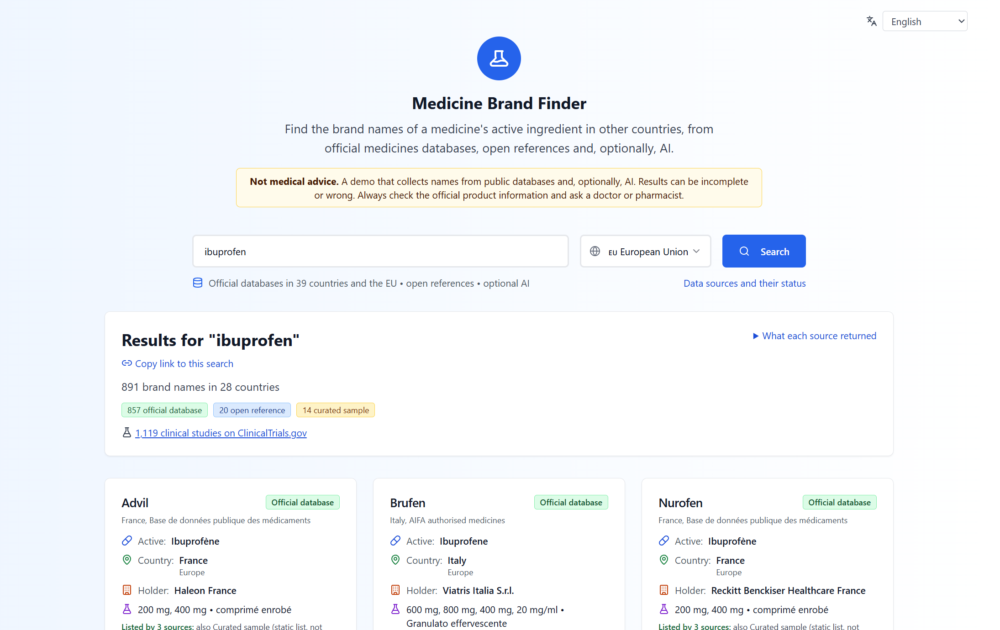
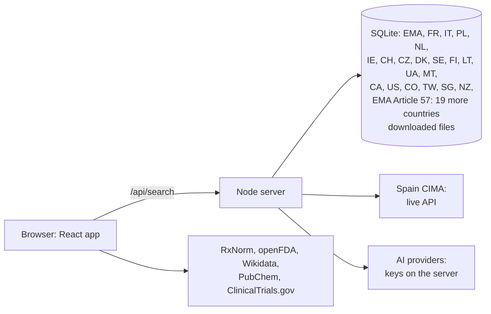

# Welcome to Medicine Brand Finder

> [!WARNING]
> **Proof-of-concept / demo — not medical advice.** Results are aggregated from
> third-party data sources and AI engines and may be inaccurate, incomplete, or
> out of date. Do not use this tool for diagnosis, treatment, prescribing, or
> dispensing decisions. Always consult a qualified healthcare professional and
> official drug labeling.

**Live:** https://medicine-finder.up.railway.app/

Type an active ingredient (for example *ibuprofen*) or a brand name (*Nurofen*) and get the brand
names it is sold under in other countries. The names come from official medicines databases, open references and, when
keys are configured, AI. Every result says where it came from.



## Project info

Medicine Finder uses several online free medicine APIs (in RxNorm international format or others) and other 3rd party AI engines calls and Databases, to search for an active drug medicine substance component and return all known brands, medicines, containing the specified substance, useful for finding medicines in different other countries by doctor's prescription, moving patient data from one system into another and other international usages.

Since version 2.0 the project has a small backend: a Node server that serves the app and an `/api`
for the official databases and AI engines a browser cannot call directly. It is still a
proof-of-concept MVP, not a production medical service.

**Live demo:** deployed on Railway. Official data from the EU and 39 countries and the open US
references work without keys. AI suggestions appear when a provider key is set on the server; keys
never reach the browser.

## What it searches

| Type | Sources | Countries |
|---|---|---|
| **Official database** | [EMA](https://www.ema.europa.eu/en/medicines/download-medicine-data) (EU), France [BDPM](https://base-donnees-publique.medicaments.gouv.fr/), Italy [AIFA](https://www.aifa.gov.it/liste-dei-farmaci), Poland [URPL](https://rejestry.ezdrowie.gov.pl/rpl/search/public), Netherlands [CBG](https://www.geneesmiddeleninformatiebank.nl/), Ireland [HPRA](https://www.hpra.ie/find-a-medicine), Switzerland [Swissmedic](https://www.swissmedic.ch/swissmedic/en/home/services/listen_neu.html), Czech Republic [SÚKL](https://prehledy.sukl.cz/prehled_leciv.html), Denmark [DKMA](https://laegemiddelstyrelsen.dk/en/licensing/licensing-of-medicines/lists-of-authorised-and-deregistered-medicines/), Sweden [Läkemedelsverket](https://www.lakemedelsverket.se/), Finland [Fimea](https://fimea.fi/en/databases_and_registers/basic-register-xml) (imported file), Lithuania [VVKT](https://data.gov.lt/datasets/2853/), Ukraine [State Register](https://data.gov.ua/dataset/fded13b8-4e2c-4c48-bf14-65d0e3106463), Malta [Medicines Authority](https://medicinesauthority.gov.mt/advanced-search), [Health Canada DPD](https://health-products.canada.ca/dpd-bdpp/), US [FDA NDC Directory](https://www.fda.gov/drugs/drug-approvals-and-databases/national-drug-code-directory), Colombia [INVIMA](https://www.datos.gov.co/Salud-y-Protecci-n-Social/C-digo-nico-de-Medicamentos-Vigentes/i7cb-raxc), Taiwan [TFDA](https://data.gov.tw/dataset/9122), Singapore [HSA](https://data.gov.sg/datasets/d_767279312753558cbf19d48344577084/view), New Zealand [Pharmac](https://schedule.pharmac.govt.nz/) (funded medicines), Spain [CIMA](https://cima.aemps.es/); [EMA Article 57](https://www.ema.europa.eu/en/human-regulatory-overview/post-authorisation/data-medicines-iso-idmp-standards-post-authorisation/public-data-article-57-database) for the other EEA countries and Northern Ireland | EU, FR, IT, PL, NL, IE, CH, CZ, DK, SE, FI, LT, UA, MT, CA, US, CO, TW, SG, NZ, ES; AT, BE, BG, HR, CY, EE, DE, GR, HU, IS, LV, LI, LU, NO, PT, RO, SK, SI, UK (Article 57): EU and 39 countries |
| **Open reference** | [RxNorm](https://www.nlm.nih.gov/research/umls/rxnorm/), [openFDA](https://open.fda.gov/) drug labels, [Wikidata](https://www.wikidata.org/), [PubChem](https://pubchem.ncbi.nlm.nih.gov/) synonyms; [ClinicalTrials.gov](https://clinicaltrials.gov/) study count | US, any |
| **Curated sample** | static lists for a few common ingredients, typed into the app; not from a regulator | EU, DE, FR, IT, ES, NL, UK, IN |
| **AI suggestion** | OpenAI, Perplexity, DeepSeek, OpenRouter, each only if its key is set; unverified | any |

The **Data sources** page (`/sources`) shows each source's live status and terms of use. Other
national registers that were checked, and why they are not used yet, are listed in
[docs/DATA-SOURCES.md](docs/DATA-SOURCES.md). Results are ordered by
reliability: official data first, then open references, curated samples and AI; single-ingredient
products before combinations; brands listed by several sources first ("Listed by N sources").

**Country or region:** choose one and you get that country's data, then EU-wide authorisations (EU
and EEA members) and worldwide references. If there is no data for it yet, the app shows the same
region, or all countries, and says so. "Acetaminophen", "paracetamol" and "acetaminofén" (and
other names of the same ingredient) find each other.

**Brand names:** type a brand ("Nurofen") and the app finds its active ingredient in the registers,
says so ("Nurofen is a brand name of Ibuprofen"), and shows that ingredient's brands everywhere. When
the same brand name stands for a different ingredient in another country, a warning says where.

**Links and downloads:** the address shows the search (`/?q=ibuprofen&country=Germany`), so it can
be bookmarked or sent. At the end of the results, "Download" gives the same rows as **CSV** (RFC 4180,
UTF-8, opens in Excel and LibreOffice), an **Excel workbook** (XLSX, with a "Sources" sheet), **JSON**,
or an **HL7 FHIR R4** Bundle for health-record systems (one `Medication` per brand, ingredients coded
with RxNorm where the US National Library of Medicine knows them, a `Provenance` naming the sources;
checked against HL7's official R4 JSON Schema in the tests). Every row names its source, that
source's terms and any condition of reuse (Malta: not commercial; Colombia: share-alike; EMA: name
EMA in every copy); AI suggestions are marked, and left out of the FHIR file.

**Languages:** the interface is in 20 languages (English, German, French, Spanish, Italian,
Portuguese, Polish, Dutch, Romanian, Czech, Hungarian, Greek, Swedish, Danish, Finnish, Norwegian,
Ukrainian, Lithuanian, Japanese, Traditional Chinese), chosen from the browser's language or the
switch at the top; `/?lang=de` links to one. Translations other than English are machine-made and
marked "not reviewed" in their files until a person reviews them. Register data (brands,
ingredients, statuses) is shown as published; country names follow the chosen language.

**Other names of an ingredient:** a search also finds the ingredient under its other official names
(US/INN pairs, national spellings, Latin forms such as "Natrii chloridum") from a hand-made list and
from the US FDA's UNII list (public domain; `scripts/build-unii-synonyms.mjs`). When the search server
cannot be reached, the browser still turns a US brand name into its ingredient through RxNorm.

## How it works



All sources run in parallel, each with a time limit. Official results appear within seconds; AI
suggestions follow from a separate endpoint. The last 50 searches are kept in the browser for a
day. The app merges the answers into one card per brand and country, preferring official data. A summary for AI tools is in
[public/llms.txt](public/llms.txt) (served at `/llms.txt`). The details are in
[docs/ARCHITECTURE.md](docs/ARCHITECTURE.md), and the API in [docs/API.md](docs/API.md).

## What technologies are used for this project?

This project is automatically and manually built with:
- TypeScript
- React
- Lovable
- Vite
- shadcn-ui
- Tailwind CSS
- Node.js 22 server (no runtime dependencies), SQLite (built into Node), Docker
- Railway (default deployment), Vercel (optional, off by default)
- OpenAI, Perplexity, DeepSeek and OpenRouter.ai integrations (optional)
- Ajv (MIT, development only): checks the FHIR download against HL7's official R4 JSON Schema in the tests


## API keys

All data sources (RxNorm, OpenFDA, EMA, EMA Article 57, BDPM, AIFA, URPL, CBG, HPRA, Swissmedic, SÚKL, DKMA, Läkemedelsverket, Fimea, VVKT, Ukraine's register, Malta's Medicines
Authority, FDA NDC, INVIMA, TFDA, HSA, Pharmac, CIMA,
Health Canada, ClinicalTrials, PubChem, Wikidata) are free and do not require API keys (openFDA
accepts an optional one, below). DeepSeek/OpenRouter offers a free tier with generous limits if you
register to use it.

AI keys are **server variables** (`OPENAI_API_KEY`, `PERPLEXITY_API_KEY`, `DEEPSEEK_API_KEY`,
`OPENROUTER_API_KEY`), set in Railway or in a local `.env`. They are never bundled into the browser
build. See [.env.example](./.env.example) and [docs/DEPLOY.md](docs/DEPLOY.md).

Optional data keys work the same way: with `OPENFDA_API_KEY` set, the server queries openFDA (120,000
calls a day, cached) instead of each browser; without it nothing changes.

## Run & test

```bash
npm ci               # install (Node 22.13 or later: package.json "engines")
npm run dev          # app only, http://localhost:8080
npm run build        # production build
npm start            # app + /api from dist/ on http://localhost:8080
npm run lint         # ESLint (app and server)
npm run typecheck    # strict TypeScript check
npm test             # Vitest: server sources, API, merging, browser sources
docker build -t medicine-finder . && docker run --rm -p 8080:8080 medicine-finder
```

## Deploy

- **Railway (default):** pushes to `main` build the `Dockerfile` (see `.railway/railway.ts`); the
  health check is `/api/health`; a volume at `/app/data` keeps the database across deploys.
- **Vercel (off):** `vercel.json` keeps Git deployments disabled. [docs/DEPLOY.md](docs/DEPLOY.md)
  has the on/off switch.

## Manual review checklist

- **config:** copy `.env.example` → `.env`; free sources need no keys; AI keys optional and server-side
- **run:** `npm ci` → `npm run build` → `npm start`
- **examples:** search an active ingredient (e.g. "ibuprofen", "paracetamol", "amoxicillin") to list brands/medicines
- **result:** merged brand list labelled by source type (official / open reference / curated / AI), with links to the source records; `/sources` shows each source's status
- **path:** browser sources and merging in `src/lib/search/`, server in `server/` (sources in `server/sources/`)

## Security

See [SECURITY.md](SECURITY.md). In short: keys stay on the server; searches are validated,
rate-limited and cached; AI use has a daily cap; pages send a strict Content Security Policy.

## Licence

GNU General Public License v3.0 or later, see [LICENSE](LICENSE). Data-source terms and the NLM
attribution are in [NOTICE.md](NOTICE.md).
