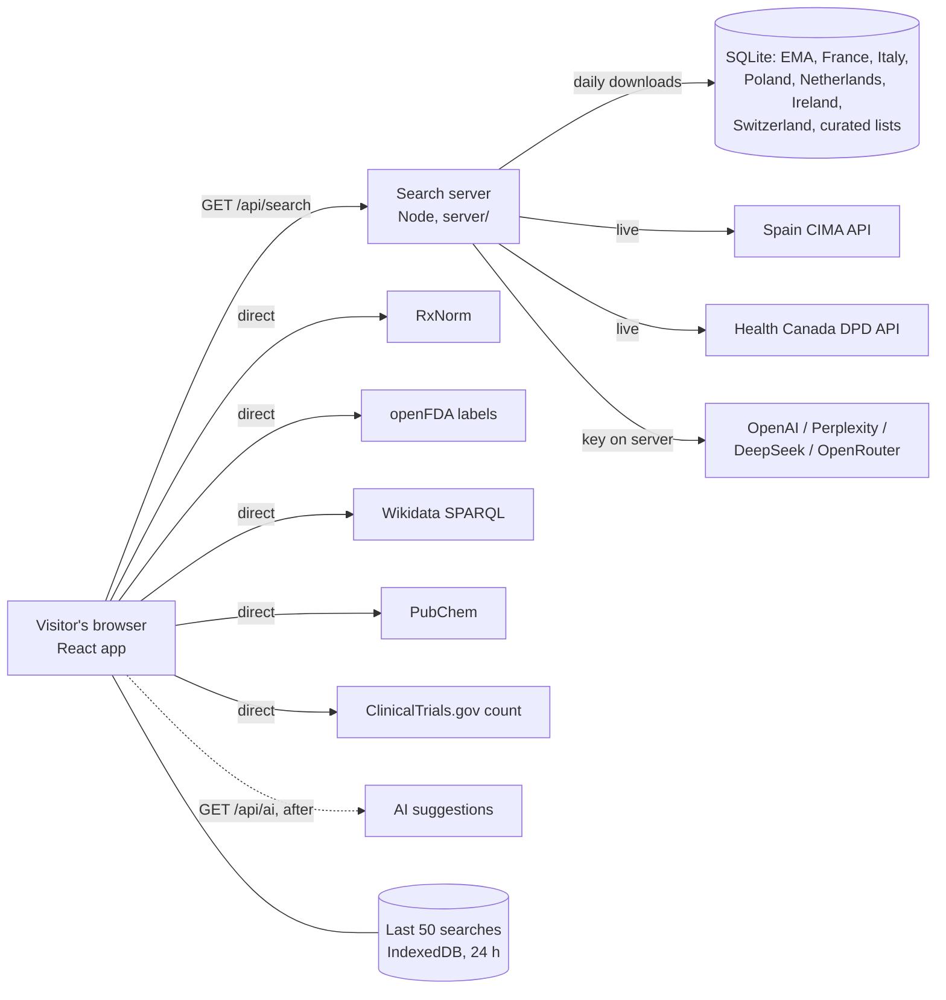

# Architecture

Medicine Brand Finder has two parts in one deployment:

- **The web app** (React, Vite, Tailwind, shadcn/ui) in `src/`. It runs in the visitor's browser,
  calls the open sources that allow cross-origin requests, and calls the server for the rest.
- **The search server** (Node 22, no runtime npm dependencies) in `server/`. It serves the built app
  from `dist/`, and `/api` for the official databases and AI providers that a browser cannot call:
  they block cross-origin requests, need a key, or ship as bulk files.



## A search, step by step

1. The visitor enters an active ingredient (and optionally a country).
2. The app starts every source at once and shows each one's progress
   (`src/lib/search/searchMedicines.ts`).
3. Browser sources (`src/lib/search/browserSources.ts`) answer directly.
4. `GET /api/search` (`server/search.js`) runs the server sources in parallel (the national
   datasets in SQLite, Spain and Canada live), each with a time limit, and returns their results
   plus one status line per source. The results are shown at once.
5. `GET /api/ai` then asks the AI providers that have a key; their suggestions are merged in when
   they arrive. A suggestion that matches a database record only adds to that record's sources.
6. The app merges everything: one card per brand and country, taken from the most reliable source
   (official, then open reference, then curated, then AI). Other sources that list the same brand are
   shown as "Also listed by". Results without a country are folded into a matching brand.
7. Order: official, open reference, curated, AI; within those, RxNorm before openFDA before
   Wikidata before PubChem; single-ingredient products before combinations; brands more sources
   agree on first.
8. With a country selected (`src/lib/search/countryScope.ts`): that country, then EU-wide results
   for EU/EEA members, then results without a stated country. With no data for the country, the
   same region; with none there either, all countries, with a note. Regions can be chosen too.
9. The finished search is saved in the browser (`src/lib/search/resultCache.ts`, IndexedDB, last
   50 searches, 24 h); "Search again" bypasses it.

## Source types

| Type | Meaning | Sources |
|---|---|---|
| Official database | a regulator's or ministry's public data | EMA (EU), BDPM (France), CIMA (Spain), Health Canada DPD |
| Open reference | open public reference data, good but not a register of marketed products | RxNorm, openFDA labels, Wikidata, PubChem synonyms |
| Curated sample | static lists typed into the app for a few common ingredients | `src/lib/search/curatedLists.ts` |
| AI suggestion | a language model's answer, never verified | OpenAI, Perplexity, DeepSeek, OpenRouter (each only when its key is set) |

Every result card names its source and type. Curated and AI cards carry a warning. Nothing is
generated when a source has no data: an unknown ingredient returns no results.

## Server data handling

The national datasets are downloaded by `server/datasets/*.js` into SQLite (`server/db/store.js`,
Node's built-in `node:sqlite`): one dataset at a time in the background at start, then whenever a
dataset is more than a day old (checked hourly). A failed download keeps the previous data and is
retried after an hour; an empty download never replaces good data. Without a volume at
`DATA_DIR`, the database is rebuilt after each deploy (about 3 minutes; sources show "loading").

| Dataset | File | Rows (Oct 2026) |
|---|---|---|
| EMA (EU) | `medicines-output-medicines_json-report_en.json`, authorised human medicines | 1,566 |
| France BDPM | `CIS_bdpm.txt` + `CIS_COMPO_bdpm.txt` (ISO-8859-1), marketed, active authorisation | 13,648 |
| Italy AIFA | `confezioni.csv` (`;`), authorised, merged per medicine and strength | 23,464 |
| Poland URPL | public register CSV (`;`), human products, Latin INN | 20,289 |
| Netherlands CBG | `metadata.csv` (`|`), no homeopathics | 18,141 |
| Ireland HPRA | `latestHMlist.xml`, not those marked not marketed | 8,242 |
| Switzerland | Swissmedic "Zugelassene Packungen" `.xlsx` (read by `server/lib/xlsx.js`) | 10,303 |
| Curated sample | `server/data/curated.json` | 104 |

Live per search: Spain CIMA (`practiv1=<stem>&comerc=1`), Health Canada (`activeingredient`, then
`drugproduct` per drug code, up to 40). Each searches both international names
(`server/data/synonyms.json`).

English ingredient names are matched to French and Spanish names by word stems
(`amoxicillin` → `amoxicil` matches `amoxicilline` and `amoxicilina`), see `server/lib/text.js`.

Search answers are cached for an hour (5 minutes when a source failed), AI answers for a day, keyed
by ingredient and country.

## Limits and protection

- Search terms: 2–80 letters, digits, spaces and `.,'()/+-`; anything else gets HTTP 400.
- 20 searches and 10 AI requests per minute per visitor (`SEARCH_RATE_LIMIT`, `AI_RATE_LIMIT`),
  HTTP 429 with `Retry-After` after that.
- AI calls are capped per day across all visitors (`AI_DAILY_LIMIT`, default 500); AI keys never reach
  the browser.
- Each source has a time limit (35 s for data sources and 50 s for AI on the server, 12 s in the
  browser) so one slow source never blocks the answer. OpenRouter is called with reasoning off.
- Static responses carry a Content Security Policy (scripts from the same origin only; network
  access only to the listed sources), `X-Frame-Options: DENY`, `nosniff`, HSTS and a referrer policy.
- The container runs as the unprivileged `node` user.

## Files

```
server/            search server (plain JavaScript, ES modules)
  index.js         entry point, configuration from environment variables
  app.js           HTTP routes, static files, headers, compression
  search.js        runs a set of sources, caching, AI daily cap
  db/store.js      SQLite store: products, ingredient words, dataset status
  datasets/        one loader per national dataset + the background runner (index.js)
  data/            curated.json (static samples), synonyms.json (INN/US names)
  sources/         live sources: cima.js, healthCanada.js, ai.js
  lib/             text matching, CSV and XLSX readers, HTTP helpers, cache, rate limiter
  test/            server tests (Vitest)
src/
  lib/search/      browser sources, server client, merging and ranking, country scope, browser cache
  pages/           Index (search), Sources (data sources and their status), NotFound
  components/      search box, progress, results, cards
tests/             browser-side tests (Vitest)
```

## Where to change what

| Task | File |
|---|---|
| Add or fix a national dataset | `server/datasets/<country>.js`, listed in `server/datasets/index.js` |
| Database | `server/db/store.js` |
| Live server sources (Spain, Canada, AI) | `server/sources/` |
| Routes, headers, static files | `server/app.js`; settings and wiring in `server/index.js` |
| Name matching, INN/US name pairs | `server/lib/text.js`, `server/data/synonyms.json` |
| Browser sources | `src/lib/search/browserSources.ts` |
| Merging, ranking, AI phase | `src/lib/search/searchMedicines.ts` |
| Country and region fallbacks | `src/lib/search/countryScope.ts` |
| Browser cache | `src/lib/search/resultCache.ts` |

Rules: never invent data (every result keeps its source and `kind`); keys only in server
variables; tests stub `fetch` and use fixed clocks; a new source needs a parser test, its terms in
`NOTICE.md` and a line in the README table.
