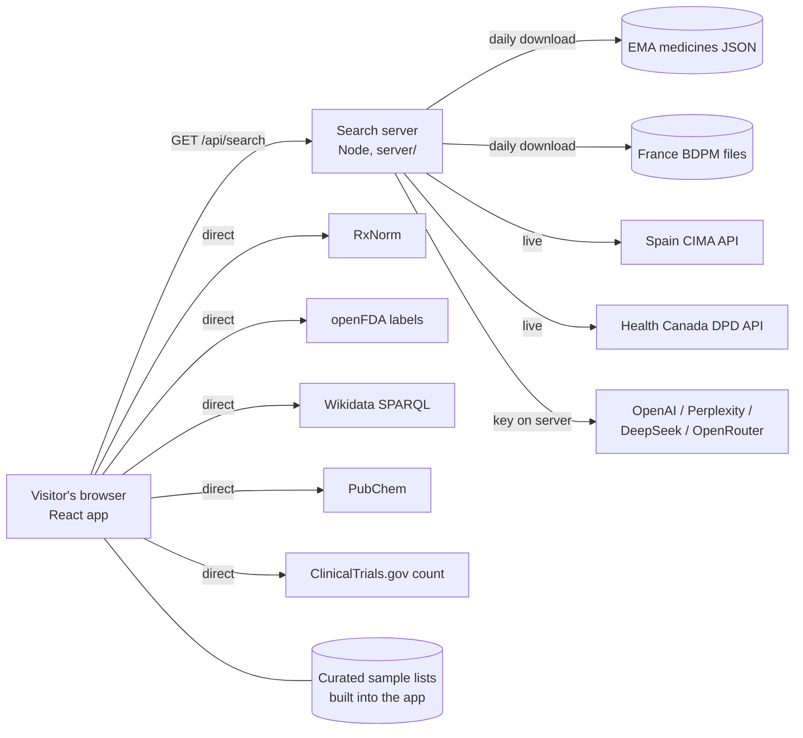

# Architecture

Medicine Brand Finder has two parts in one deployment:

- **The web app** (React, Vite, Tailwind, shadcn/ui) in `src/`. It runs in the visitor's browser,
  calls the open sources that allow cross-origin requests, and calls the server for the rest.
- **The search server** (Node 22, no runtime npm dependencies) in `server/`. It serves the built app
  from `dist/`, and `/api` for the official databases and AI providers that a browser cannot call:
  they block cross-origin requests, need a key, or ship as bulk files.



## A search, step by step

1. The visitor enters an active ingredient (and optionally a country).
2. The app starts every source at once and shows each one's progress
   (`src/lib/search/searchMedicines.ts`).
3. Browser sources (`src/lib/search/browserSources.ts`) and the curated lists
   (`src/lib/search/curated.ts`) answer directly.
4. `GET /api/search` (`server/search.js`) runs the server sources in parallel, each with a time limit,
   and returns their results plus one status line per source.
5. The app merges everything: one card per brand and country, taken from the most reliable source
   (official, then open reference, then curated, then AI). Other sources that list the same brand are
   shown as "Also listed by". Results without a country are folded into a matching brand.
6. With a country selected, results for that country, EU-wide results (for EU members) and results
   without a stated country are kept.

## Source types

| Type | Meaning | Sources |
|---|---|---|
| Official database | a regulator's or ministry's public data | EMA (EU), BDPM (France), CIMA (Spain), Health Canada DPD |
| Open reference | open public reference data, good but not a register of marketed products | RxNorm, openFDA labels, Wikidata, PubChem synonyms |
| Curated sample | static lists typed into the app for a few common ingredients | `src/lib/search/curatedLists.ts` |
| AI suggestion | a language model's answer, never verified | OpenAI, Perplexity, DeepSeek, OpenRouter (each only when its key is set) |

Every result card names its source and type. Curated and AI cards carry a warning. Nothing is
generated when a source has no data: an unknown ingredient returns no results.

## Server data handling

| Source | How | Refresh |
|---|---|---|
| EMA | `medicines-output-medicines_json-report_en.json` (about 7 MB), authorised human medicines only | daily, in memory |
| BDPM | `CIS_bdpm.txt` + `CIS_COMPO_bdpm.txt` (ISO-8859-1), marketed products with an active authorisation | daily, in memory |
| CIMA | `GET /cima/rest/medicamentos?practiv1=<stem>&comerc=1` | each search |
| Health Canada | `activeingredient` then `drugproduct` per drug code (up to 40) | each search |
| AI | one chat request per provider, JSON array answer, up to 10 names | each search |

English ingredient names are matched to French and Spanish names by word stems
(`amoxicillin` → `amoxicil` matches `amoxicilline` and `amoxicilina`), see `server/lib/text.js`.

Search answers are cached for an hour (5 minutes when a source failed), keyed by ingredient and
country. The datasets keep serving the last good copy if a refresh fails.

## Limits and protection

- Search terms: 2–80 letters, digits, spaces and `.,'()/+-`; anything else gets HTTP 400.
- 20 searches per minute per visitor (`SEARCH_RATE_LIMIT`), HTTP 429 with `Retry-After` after that.
- AI calls are capped per day across all visitors (`AI_DAILY_LIMIT`, default 500); AI keys never reach
  the browser.
- Each source has a time limit (35 s on the server, 12 s in the browser) so one slow source never
  blocks the answer.
- Static responses carry a Content Security Policy (scripts from the same origin only; network
  access only to the listed sources), `X-Frame-Options: DENY`, `nosniff`, HSTS and a referrer policy.
- The container runs as the unprivileged `node` user.

## Files

```
server/            search server (plain JavaScript, ES modules)
  index.js         entry point, configuration from environment variables
  app.js           HTTP routes, static files, headers, compression
  search.js        runs the server sources, caching, AI daily cap
  sources/         ema.js, bdpm.js, cima.js, healthCanada.js, ai.js, dataset.js
  lib/             text matching, HTTP helpers, cache, rate limiter
  test/            server tests (Vitest)
src/
  lib/search/      browser sources, curated lists, server client, merging
  pages/           Index (search), Sources (data sources and their status), NotFound
  components/      search box, progress, results, cards
tests/             browser-side tests (Vitest)
```
