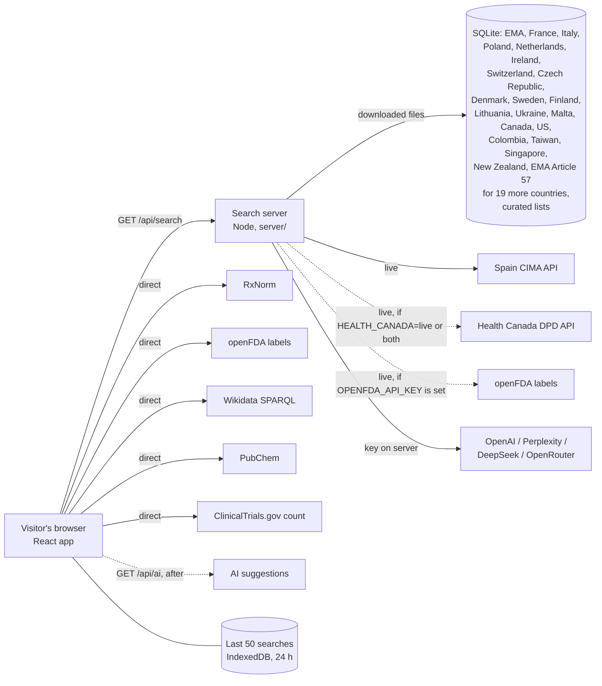

# Architecture

Medicine Brand Finder has two parts in one deployment:

- **The web app** (React, Vite, Tailwind, shadcn/ui) in `src/`. It runs in the visitor's browser,
  calls the open sources that allow cross-origin requests, and calls the server for the rest.
- **The search server** (Node 22, no runtime npm dependencies) in `server/`. It serves the built app
  from `dist/`, and `/api` for the official databases and AI providers that a browser cannot call:
  they block cross-origin requests, need a key, or ship as bulk files.



## A search, step by step

1. The visitor enters an active ingredient (and optionally a country).
2. The app starts every source at once and shows each one's progress
   (`src/lib/search/searchMedicines.ts`).
3. Browser sources (`src/lib/search/browserSources.ts`) answer directly.
4. `GET /api/search` (`server/search.js`) runs the server sources in parallel (the national
   datasets in SQLite, Spain and Canada live), each with a time limit, and returns their results
   plus one status line per source. The results are shown at once.
5. `GET /api/ai` then asks the AI providers that have a key; their suggestions are merged in when
   they arrive. A suggestion that matches a database record only adds to that record's sources.
6. The app merges everything: one card per brand and country, taken from the most reliable source
   (official, then open reference, then curated, then AI). Other sources that list the same brand are
   shown as "Also listed by". Results without a country are folded into a matching brand.
7. Order: official, open reference, curated, AI; within those, RxNorm before openFDA before
   Wikidata before PubChem; single-ingredient products before combinations; brands more sources
   agree on first.
8. With a country selected (`src/lib/search/countryScope.ts`): that country, then EU-wide results
   for EU/EEA members, then results without a stated country. With no data for the country, the
   same region; with none there either, all countries, with a note. Regions can be chosen too.
9. The finished search is saved in the browser (`src/lib/search/resultCache.ts`, IndexedDB, last
   50 searches, 24 h); "Search again" bypasses it.

## Source types

| Type | Meaning | Sources |
|---|---|---|
| Official database | a regulator's or ministry's public data | EMA (EU), the national registers of France, Italy, Poland, the Netherlands, Ireland, Switzerland, the Czech Republic, Denmark, Sweden, Finland, Lithuania, Ukraine, Malta, Canada, the United States, Colombia, Taiwan, Singapore and New Zealand, CIMA (Spain); EMA's Article 57 extract for 18 other EEA countries and Northern Ireland |
| Open reference | open public reference data, good but not a register of marketed products | RxNorm, openFDA labels, Wikidata, PubChem synonyms |
| Curated sample | static lists typed into the app for a few common ingredients | `server/data/curated.json` |
| AI suggestion | a language model's answer, never verified | OpenAI, Perplexity, DeepSeek, OpenRouter (each only when its key is set) |

Every result card names its source and type. Curated and AI cards carry a warning. Nothing is
generated when a source has no data: an unknown ingredient returns no results.

## Server data handling

The national datasets are downloaded by `server/datasets/*.js` into SQLite (`server/db/store.js`,
Node's built-in `node:sqlite`): one dataset at a time in the background at start, then whenever a
dataset is older than its refresh interval (a day, or a week for files published monthly or
large ones; checked hourly). Imported files (Finland) are reloaded when the file is newer than the
data. A failed download keeps the previous data and is retried after an hour (an imported file at
once, when a newer one is put in place); an empty download never replaces good data. On Railway a volume at
`DATA_DIR` (`/app/data`) keeps the database across deploys; without one it is rebuilt after each
deploy (about 3 minutes; sources show "loading").

| Dataset | File | Rows (Oct 2026) |
|---|---|---|
| EMA (EU) | `medicines-output-medicines_json-report_en.json`, authorised human medicines; `;`-separated substances joined with ` + ` | 1,566 |
| France BDPM | `CIS_bdpm.txt` + `CIS_COMPO_bdpm.txt` (ISO-8859-1), marketed, active authorisation | 13,648 |
| Italy AIFA | `confezioni.csv` (`;`), authorised, merged per medicine and strength | 23,464 |
| Poland URPL | public register CSV (`;`), human products, Latin INN | 20,289 |
| Netherlands CBG | `metadata.csv` (pipe-separated), no homeopathics | 18,141 |
| Ireland HPRA | `latestHMlist.xml`, not those marked not marketed | 8,242 |
| Switzerland | Swissmedic "Zugelassene Packungen" `.xlsx` (read by `server/lib/xlsx.js`) | 10,303 |
| Czech Republic SÚKL | monthly DLP zip (`;`, windows-1250), linked from the open-data catalogue page; registered products, English substance names; no homeopathics or parallel imports | 11,701 |
| Denmark DKMA | list of authorised medicines `.xlsx` (daily), no parallel imports, natural medicines, vitamins or veterinary products (ATC Q) | 12,242 |
| Sweden Läkemedelsverket | `Lakemedelsprodukter.xlsx` (daily), human, approved or registered, no parallel imports or homeopathics | 13,540 |
| Finland Fimea | `Perusrekisteri.xml` imported by hand into `DATA_DIR/imports` (fimea.fi blocks scripts), reloaded when the file is newer; human, current authorisation or registration, no parallel imports; substances joined through the packages; duplicates dropped | 11,673 |
| Lithuania VVKT | data.gov.lt CSV (one row per package), registered or re-registered, no parallel imports or distribution, grouped per product; English ATC substance name for 7-character codes, else the Lithuanian substances | 4,458 |
| Ukraine | State Register `reestr.csv` (windows-1251), not terminated early, no substances or homeopathics; INN as ingredient (no "combinations" parts); short form and strength | 10,945 |
| Malta Medicines Authority | national products `.xlsx` (daily), authorised; brand cut back from form and strength text | 5,360 |
| Canada (Health Canada) | DPD data extract `allfiles.zip` (marketed products), human medicines whose current status is MARKETED | 11,463 |
| United States FDA | NDC Directory `ndctext.zip` → `product.txt`, human Rx/OTC, still marketed (no end date, or a future one), not excluded; no homeopathics, medical gases, or generics whose brand is the generic name | 45,943 |
| Colombia INVIMA | CUM on datos.gov.co, filtered by the portal (`$where` current + active), grouped per registration; brands and substances cut back from form, strength and "equivalente" text | 9,343 |
| Taiwan TFDA | open data set 36 (zip with one 79 MB JSON), licences not cancelled or expired, finished products and biologics; brands without form, strength or maker tag | 18,305 |
| Singapore HSA | data.gov.sg CSV (a signed link requested each time); brands and substances cut back from form and strength text | 5,475 |
| New Zealand Pharmac | monthly Pharmaceutical Schedule XML, funded medicines only | 2,361 |
| EEA (EMA Article 57) | public extract of the Article 57 database (one `.xlsx`, header row found by its text); only countries without their own dataset here (AT, BE, BG, HR, CY, EE, DE, GR, HU, IS, LV, LI, LU, NO, PT, RO, SK, SI and Northern Ireland, shown as the United Kingdom); routes merged; "generic name + company" names marked in `status`; the pharmacovigilance e-mail and phone columns are never read | 89,285 |
| Curated sample | `server/data/curated.json` | 104 |

Live per search: Spain CIMA (`practiv1=<stem>&comerc=1`); and only when `HEALTH_CANADA` is `live`
or `both`, the Health Canada API (`activeingredient`, then `drugproduct` per drug code, up to 40).
When that API is down (5xx, timeout) the source shows "not available" rather than "failed"; with
the default `dataset` setting Canada always answers from the extract. Each searches every name of the
ingredient (`server/data/synonyms.json`), as do the datasets.

English ingredient names are matched to French and Spanish names by word stems
(`amoxicillin` → `amoxicil` matches `amoxicilline` and `amoxicilina`), see `server/lib/text.js`.

Search answers are cached for an hour (5 minutes when a source failed), AI answers for a day, keyed
by ingredient and country.

### Brand names

`store.replace` also indexes each product's brand (`brands` table, normalised: "Nurofen Junior" ->
`nurofen junior`). Before a search, `resolveBrand` checks whether the term is an ingredient (or
another name of one) in any loaded dataset; if not, and products carry that brand name (or start
with it and a space), it picks the ingredient most of them contain (single-ingredient products
first, English-language registers preferred) and every source is asked for that ingredient. The
answer carries `brand`, with `others` when the same name stands for another ingredient elsewhere.
The browser then asks its own sources, ClinicalTrials.gov and the AI phase for the ingredient too.
Raising `DATA_FORMAT` to 3 reloads every dataset once after the deploy, which fills the brand index.

## Limits and protection

- Search terms: 2–80 letters, digits, spaces and `.,'()/+-`; anything else gets HTTP 400.
- 20 searches and 10 AI requests per minute per visitor (`SEARCH_RATE_LIMIT`, `AI_RATE_LIMIT`; sliding
  window keyed on `X-Real-IP`) and 300 / 60 for all visitors together (`GLOBAL_*_RATE_LIMIT`), HTTP 429
  with `Retry-After` after that.
- AI calls are capped per day across all visitors (`AI_DAILY_LIMIT`, default 500); AI keys never reach
  the browser.
- Each source has a time limit (35 s for data sources and 50 s for AI on the server, 12 s in the
  browser) so one slow source never blocks the answer. OpenRouter is called with reasoning off.
- Static responses carry a Content Security Policy (scripts from the same origin only, no inline
  event handlers; network access only to the listed sources), `X-Frame-Options: DENY`, `nosniff`,
  HSTS, a referrer policy, `Cross-Origin-Opener-Policy`, `Cross-Origin-Resource-Policy` (same-origin;
  cross-origin for `/api` and the published files), `Origin-Agent-Cluster` and
  `X-Permitted-Cross-Domain-Policies`.
- The image runs as the unprivileged `node` user (on Railway as root, so it can write the volume; see
  SECURITY.md).
- Search answers over 1 KB are sent gzip-compressed (each answer compressed once, kept by ETag);
  downloads are capped at 300 MB.
- Caching: an answer is kept in memory (least recently used out first, 64 MB at most) and in SQLite
  (`answers` table, at most 300 answers per kind, pruned at most every 5 minutes; a database error
  never fails a search) for `SEARCH_CACHE_SECONDS` (AI: `AI_CACHE_SECONDS`), so it survives Railway's
  sleep; a failed source shortens that to 5 minutes. Identical searches at the same time share one
  round. Browsers may keep `/api/search` answers 60 s (then revalidate with the ETag, `304`), AI answers
  5 minutes in their own cache only, `/api/sources` 30 s; errors are never kept. Once a day the 50 most
  searched terms of the last 30 days are searched again (`queries` table: term, count, last time).

## Files

```
server/            search server (plain JavaScript, ES modules)
  index.js         entry point, configuration from environment variables
  app.js           HTTP routes, static files, headers, compression
  search.js        runs a set of sources, caching, AI daily cap
  warmup.js        the daily search of the most searched terms
  db/store.js      SQLite store: products, ingredient words, brands, dataset status, cached
                   answers, counted search terms
  datasets/        one loader per national dataset + the background runner (index.js)
  data/            curated.json (static samples), synonyms.json and unii-synonyms.json (other
                   names of an ingredient)
  sources/         live sources: cima.js, healthCanada.js (+ the HEALTH_CANADA switch), openfda.js
                   (needs OPENFDA_API_KEY), ai.js
  lib/             text matching, other names (synonyms.js), CSV and XLSX readers, HTTP helpers,
                   cache, rate limiter
  test/            server tests (Vitest): parsers (datasets.test.js), downloads (loaders.test.js), ...
src/
  lib/search/      browser sources, server client, merging and ranking, country scope, browser cache
  lib/export/      CSV, XLSX, JSON and FHIR R4 downloads
  i18n/            interface languages (locales/*.json)
  pages/           Index (search), Sources (data sources and their status), NotFound
  components/      search box, progress, results, cards, download bar, language switch
tests/             browser-side tests (Vitest)
```

## Where to change what

| Task | File |
|---|---|
| Add or fix a national dataset | `server/datasets/<country>.js`, listed in `server/datasets/index.js` |
| Database | `server/db/store.js` |
| Live server sources (Spain, Canada API, AI) | `server/sources/` |
| Canada: extract, live API or both (`HEALTH_CANADA`) | `server/datasets/dpd.js`, `server/sources/healthCanada.js`, wired in `server/index.js` |
| Routes, headers, static files | `server/app.js`; settings and wiring in `server/index.js` |
| Name matching, other names of an ingredient | `server/lib/text.js`, `server/lib/synonyms.js`, `server/data/synonyms.json` |
| Browser sources | `src/lib/search/browserSources.ts` |
| Merging, ranking, AI phase | `src/lib/search/searchMedicines.ts` |
| Country and region fallbacks | `src/lib/search/countryScope.ts` |
| Browser cache | `src/lib/search/resultCache.ts` |
| Brand-name search (brand index, brand → ingredient) | `server/db/store.js` (`brands` table, `findBrands`), `resolveBrand` in `server/datasets/index.js`, `resolve` in `server/search.js` |
| Search in the address (`?q=&country=`) | `src/lib/search/searchLink.ts`, `src/pages/Index.tsx` |
| CSV, XLSX, JSON and FHIR R4 downloads | `src/lib/export/exportResults.ts`, `src/components/ExportBar.tsx`; ISO country codes in `src/lib/export/countryCodes.ts` |
| Daily warm-up of the most searched terms | `server/warmup.js` (counts in the `queries` table) |
| Countries with data (front page, country list) | `countries` on each official source; `src/lib/search/coverage.ts` |
| Interface languages (20) | `src/i18n/` (`core.tsx` t() and plurals, `I18nProvider.tsx`, `locales/*.json`); country names from `Intl.DisplayNames` |
| FHIR R4 and XLSX downloads | `src/lib/export/fhir.ts` (+ `rxnorm.ts`, extension definitions in `public/fhir/StructureDefinition/`), `src/lib/export/xlsx.ts` |
| Other names of an ingredient | `server/data/synonyms.json` (by hand), `server/data/unii-synonyms.json` (generated by `scripts/build-unii-synonyms.mjs`), Latin element names in `server/lib/synonyms.js` |
| Keyed sources (off until a key is set) | `requires` on a dataset (`server/datasets/index.js`); openFDA on the server: `server/sources/openfda.js` |
| Railway build, health check, volume | `.railway/railway.ts`; preview with `railway config plan` |

Rules: never invent data (every result keeps its source and `kind`); keys only in server
variables; tests stub `fetch` and use fixed clocks; a new source needs a parser test and a download test, its
terms in `NOTICE.md` and a line in the README table.
